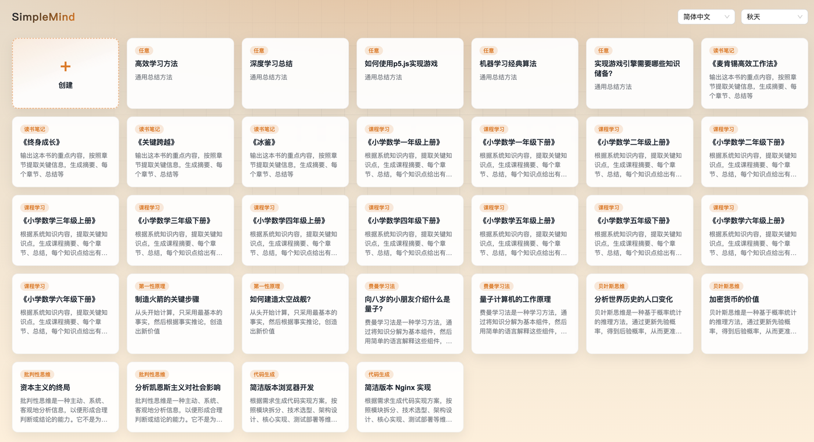
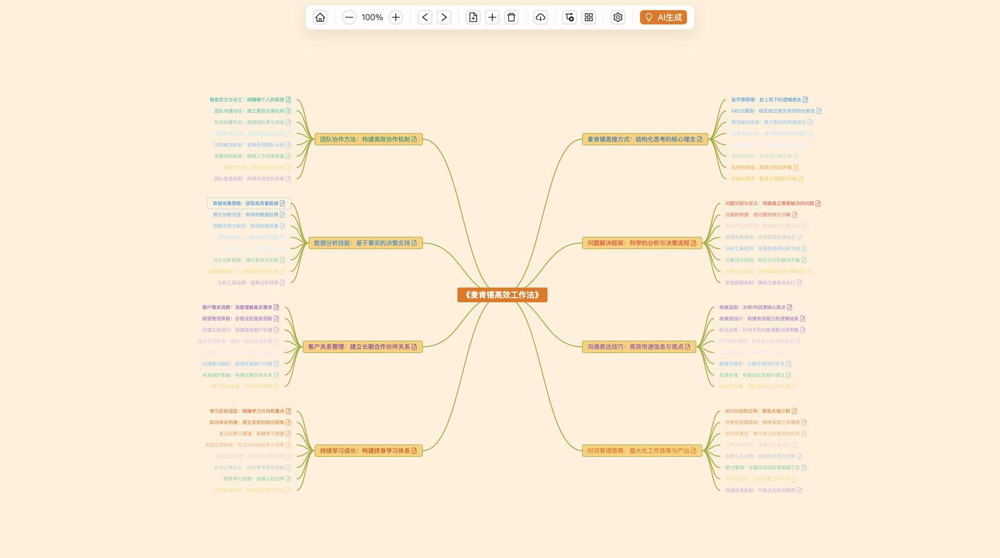
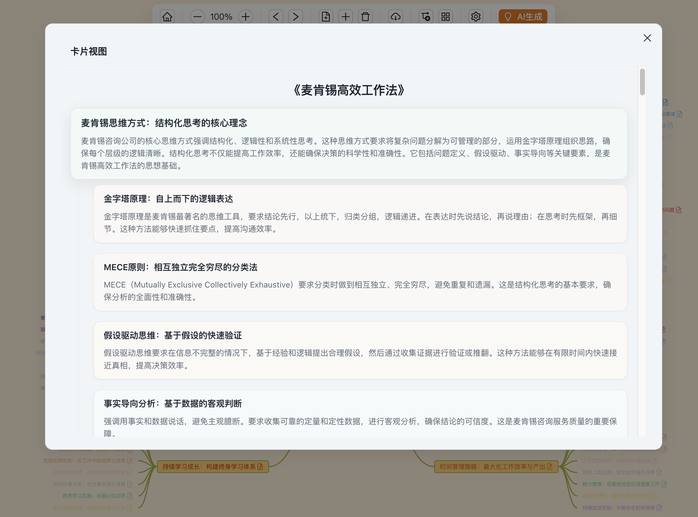

# SimpleMind

English | [中文](./README.md)

A free, in-browser mind mapping tool. The app opens on a **Home** page of template cards; in the editor, the right side is a **SimpleChat** cloud chat panel (OpenAI-compatible, configure in panel ⚙), while toolbar **AI Generate** can still use **Chrome Built-in AI** (Prompt API / Gemini Nano) on-device (**no API key** for that path).

- Live demo: https://simple-mind-five.vercel.app
- Repository: https://github.com/SimpleAI2026/SimpleMind

Stack: Vue 3, Vite 7, Ant Design Vue 4, vue-router, [simple-mind-map](https://github.com/wanglin2/mind-map).

## Screenshots (samples)

Sample screenshots of the product after the homepage redesign.

### Home



Brand **SimpleMind** on the left; language and theme selectors on the right. The main area is a “Create” card plus a grid of thinking-template example cards.

### Mind map



Editor (`/map`) shows the mind map with a **right-side SimpleChat panel** (resizable). The toolbar includes back to Home, zoom, undo/redo, add/remove nodes, import/export, detailed/simple mode, card view, settings, and AI Generate (no “Set Thinking Template” toolbar entry).

### Card view



Renders the map as layered, document-style cards; can also be exported as a standalone `card.html`.

## Features

### Home and navigation

- **Default route `/`**: tech-style Home page (not the canvas).
- **Header**: brand `SimpleMind` on the left; language and theme dropdowns on the right (same theme list as Settings via `getThemeList()`).
- **Template card grid**: first card is always “Create (+)”; remaining cards are flattened thinking-template examples (note-taking, course learning, first principles, Feynman technique, Bayesian thinking, critical thinking, code generation, and more).
- **Enter editor**: “Create” → `/map` with a new map; a template card → `/map` with that example loaded. To switch templates, go back to Home.
- **Back to Home**: explicit control at the start of the editor toolbar.

### AI generation (Built-in AI + SimpleChat)

- **Built-in AI (toolbar AI Generate)**: Chrome Prompt API (`LanguageModel` / on-device Gemini Nano). **No API key** on this path. Requires **Chrome 138+**. On failure, upgrade / download the model or shrink scope — **never** turn “AI Generate” into a cloud Completions fallback.
- **SimpleChat right chat panel**: Multi-turn cloud chat (OpenAI-compatible) + tools. Configure `apiBaseUrl` / `apiKey` / `model` in the panel top-right **⚙** (localStorage). Separate from the Built-in AI channel.
- **Thinking templates**: Default, note-taking, course learning, first principles, Feynman technique, Bayesian thinking, critical thinking, and code generation. Applied when opening from a Home card; chat system prompt auto-injects knowledge base + selected node + thinking model.
- **Generate children (Built-in)**: Select a node and click **AI Generate**. On-device defaults stay small (suggest 1–4 nodes, 1 layer, with shrink-on-failure).
- **Knowledge base**: Enter context in Settings, or upload `.md` / `.txt` / `.csv` / `.pdf` (truncated for on-device context).
- **AI expand**: Expand the knowledge base with the built-in model before generation.
- **Host tools (Chat)**: Minimal tools only — `get_selected_node` (read) and `add_child_nodes` (write children under the selection).

### SimpleChat integration (vendor, no npm portal)

- **Artifact**: In sibling [SimpleChat](https://github.com/SimpleAI2026/SimpleChat), run `yarn build:min` to build and copy into `src/vendor/simplechat/simplechat.min.js` (styles inside Shadow DOM; no extra CSS).
- **Local wrapper**: `src/components/SimpleChatSidebar.js` wraps `<simple-chat layout="panel">`. **No** Yarn portal / npm `@simplechat/*`.
- **Resizable**: Left-edge resize (~320–720px), synced with `--sc-width`, `localStorage` `simplechat:sidebar-width`, and host `--ai-panel-width`.
- **⚙ settings**: Base URL / Key / Model / Provider (incl. Chrome built-in AI) / theme / tool styles. Built-in AI comes from SimpleChat’s own panel (Mind no longer injects via `setHostSettingsSlot`). The right AI panel is expanded by default; open/closed is stored in `localStorage` (`simplemind-ai-panel-open`). If the API key starts with `my-`, SimpleChat strips the prefix and Base64-decodes before Bearer auth.
- **History**: `storageKey` is bound to the map root `uid` (`simplemind-chat-<uid>`).
- **Refresh vendor**: `cd ../SimpleChat && yarn build:min` (auto-copy by default; or `yarn build:min --no-copy` then `cp` manually).

### Editing and views

- **Toolbar**: back to Home, zoom (desktop), undo/redo, new map, add/remove nodes, import/export, detailed/simple mode, card view, settings, AI generate (**no** “Set Thinking Template” toolbar button).
- **Layouts**: mind map, logical structure, organization chart, catalog organization, timeline, fishbone.
- **Detailed / simple mode**: detailed mode appends the node note to the text; simple mode keeps the title only.
- **Card view**: renders the map as layered cards; can also be exported as a standalone `card.html`.
- **Node actions**: context menu supports add child, remove current node, remove node with children, copy / cut / paste, mark / unmark.
- **Theme and style**: built-in themes (default `mint`); custom canvas background, line color and width (1–10px), line style (curve / straight / direct), and font (Microsoft YaHei, SimSun, KaiTi, SimHei, LiSu, Arial, and others). Each style can be reset independently.
- **Language**: Simplified Chinese and English. Mouse-wheel zoom and node drag are enabled.

### Import, export, and storage

- **Export**: `.smm`, `.json`, `.svg`, `.png`, `.pdf`, `.md`, `.xmind`, `.txt`, `card.html`.
- **Import**: `.smm`, `.json`, `.xmind`, `.md`. The UI also lists `.xlsx`, but parsing is not implemented.
- **Persistence**: the web build uses the tab’s `sessionStorage`; the Chrome extension prefers `chrome.storage.local`.

## Requirements

- Node.js `^20.19.0` or `>=22.12.0`
- Yarn (the repo includes `yarn.lock`)

## Setup

```sh
yarn
```

Development:

```sh
yarn dev
```

Production build:

```sh
yarn build
```

Preview the production build:

```sh
yarn preview
```

## Install the Chrome extension

1. `yarn && yarn build:extension`
2. Chrome → `chrome://extensions` → Developer mode → Load unpacked → `dist-extension/`
3. Click the toolbar icon to open SimpleMind in a **normal Chrome tab** (full page). The editor’s **right side is the SimpleChat panel** (cloud chat ⚙; pick Chrome built-in AI provider there for Nano status).
4. Requires Chrome 138+. No API keys.

## Usage

1. Open the app (extension: toolbar icon → main tab) on Home; switch language / theme in the header.
2. Click **Create** for a blank map, or open a template card to load an example into the editor.
3. In the right **SimpleChat** panel, open **⚙**: set cloud Base URL / API Key / Model, or choose the Chrome built-in AI provider for on-device Nano status / download / recheck.
4. Select the root node or any node and set its text to the topic; optionally add material in **Knowledge Base**.
5. **Cloud chat**: talk in SimpleChat; the model can read/write the selection via tools. **On-device generate**: click toolbar **AI Generate**, confirm the prompt, and children are inserted. To switch templates, use **Back to Home**.

## Implementation notes

- Model JSON is often invalid; the app already repairs it with [`jsonrepair`](https://www.npmjs.com/package/jsonrepair) before parsing.
- The official `simple-mind-map` `TouchEvent` plugin binds touch handlers on `window` and blocks Ant Design Vue controls on mobile. This repo uses `src/plugins/TouchEvent.js`, which ignores touches whose target is outside the mind-map container.
- Routes: `/` → Home, `/map` → Editor.

## References

- [SimpleChat](https://github.com/SimpleAI2026/SimpleChat) (vendor source for the right chat panel)
- [simple-mind-map constructor methods](https://wanglin2.github.io/mind-map-docs/api/constructor/constructor-methods.html#on-event-fn)
- [Ant Design Vue](https://ant.design/)
- [Thinking frameworks: nine models](https://medium.com/vincent-chen/%E8%AE%80%E6%9B%B8%E5%BF%83%E5%BE%97-%E6%80%9D%E8%80%83%E7%9A%84%E6%A1%86%E6%9E%B6-%E4%BA%8C-%E4%B9%9D%E5%A4%A7%E6%80%9D%E7%B6%AD%E6%A8%A1%E5%9E%8B-e6e6d5ad568)
- [ProcessOn mind map templates](https://www.processon.com/template/mind_free)
- [ProcessOn mind map knowledge](https://www.processon.com/knowledge/mindmaptemplate)
